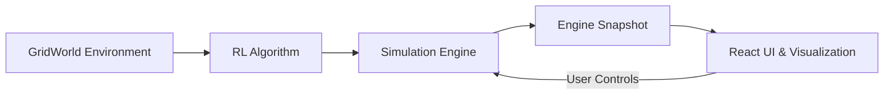

<div align="center">

<h1>🎮 RL Playground</h1>

<p><strong>강화학습의 학습 과정을 눈으로 보고, 직접 조작하는 인터랙티브 실험실</strong></p>
<p>Explore reinforcement learning, one step at a time.</p>

<p>
  
  
  
  
  
</p>

<p>
  <a href="https://oyueo-mm.github.io/RL-Playground/"><strong>🚀 Live Demo</strong></a>
  &nbsp;·&nbsp;
  <a href="#-주요-기능">주요 기능</a>
  &nbsp;·&nbsp;
  <a href="#-시작하기">시작하기</a>
  &nbsp;·&nbsp;
  <a href="#-기술-스택">기술 스택</a>
</p>

</div>

---

## 💡 프로젝트 소개

**강화학습 에이전트는 어떻게 행동을 선택하고, 보상을 통해 더 나은 정책을 학습할까?**

RL Playground는 이 질문에 대한 답을 직접 실험하며 알아볼 수 있도록 만든 **브라우저 기반 강화학습 시각화 프로젝트**입니다.

GridWorld 환경을 편집하고 Q-Learning 또는 SARSA 알고리즘으로 에이전트를 학습시키면서, 상태와 행동뿐 아니라 **Q-value, TD Target, TD Error, 정책(Policy), 에피소드별 보상 변화**까지 확인할 수 있습니다.

별도 설치나 로그인 없이 [웹 데모](https://oyueo-mm.github.io/RL-Playground/)에서 바로 실행할 수 있습니다. 강화학습 로직은 클라이언트의 TypeScript로 구현되어 있으며 **백엔드, 데이터베이스, 외부 AI API가 필요하지 않습니다.**

## ✨ 주요 기능

| 분류 | 기능 |
| :--- | :--- |
| **환경 편집** | Grid 크기 조절, 시작점·벽·목표·폭탄 배치, 보상 및 페널티 설정 |
| **환경 프리셋** | Simple Corridor, Maze, Bomb Field, Multi Goal, Treasure Hunt |
| **알고리즘** | Q-Learning(Off-policy), SARSA(On-policy) |
| **하이퍼파라미터** | 탐험률 ε, 학습률 α, 할인율 γ 실시간 조절 |
| **학습 제어** | 단일 Step, 연속 실행, Episode 단위 실행, 일시정지·재개·초기화, 속도 조절 |
| **학습 상태 분석** | State / Action / Reward / TD Target / TD Error / Q-value 업데이트 확인 |
| **정책 시각화** | Q-value 막대그래프, Greedy Policy 화살표, State Value Heatmap |
| **학습 추이 분석** | Episode별 Reward, Steps, 성공률, 종료 원인, 학습 진행 그래프 |
| **경로 분석** | Episode Trajectory를 Grid와 단계별 기록으로 확인 |
| **학습 후 평가** | Q-table을 변경하지 않는 Greedy Policy 실행 |

### 🗺️ 직접 만드는 GridWorld

환경 편집기에서 원하는 실험 상황을 구성할 수 있습니다.

- **Start / Wall / Goal / Bomb:** 시작 위치, 장애물, 목표, 위험 상태 지정
- **Reward 설정:** Step Reward, Wall Penalty, Goal Reward, Bomb Penalty 각각 조절
- **Multiple Goals:** 여러 목표를 모두 한 번씩 방문해야 에피소드 종료
- **Bomb:** 진입하면 페널티를 받고 즉시 에피소드 종료
- **Presets:** 기본 예제를 불러온 뒤 자유롭게 수정 가능

여러 Goal이 있는 경우 에이전트의 상태는 단순한 좌표가 아니라 **현재 위치와 이미 수집한 Goal 정보**를 함께 포함합니다. 따라서 같은 위치라도 남은 목표가 다르면 별도의 상태 및 Q-value로 학습합니다.

### 🧠 학습 과정을 단계별로 관찰

**Step**을 실행할 때마다 현재 상태, 선택한 행동, 받은 보상, TD Target과 TD Error, 업데이트 전후의 Q-value를 확인할 수 있습니다.

화살표로 표시되는 **Policy Overlay**, 값의 크기를 보여주는 **Value Heatmap**, 행동별 **Q-value 막대그래프**를 함께 사용하면 에이전트의 정책이 어떻게 변하는지 직관적으로 파악할 수 있습니다.

### 📈 에피소드 결과 분석

Episode History에서 개별 에피소드를 선택해 누적 보상, 이동 횟수, 종료 원인, 탐험·활용 비율 등을 살펴볼 수 있습니다. 선택한 에피소드의 실제 이동 경로와 단계별 행동도 확인할 수 있으며, Reward Chart와 Learning Progress로 학습 추이를 비교할 수 있습니다.

## 📚 구현된 강화학습 알고리즘

### Q-Learning — Off-policy TD Control

다음 상태에서 가능한 행동 중 **최대 Q-value**를 사용하여 현재 Q-value를 업데이트합니다.

$$
Q(s_t,a_t) \leftarrow Q(s_t,a_t) + \alpha \left[r_{t+1} + \gamma \max_a Q(s_{t+1},a) - Q(s_t,a_t)\right]
$$

### SARSA — On-policy TD Control

다음 상태에서 실제로 **선택한 행동의 Q-value**를 사용하여 현재 Q-value를 업데이트합니다.

$$
Q(s_t,a_t) \leftarrow Q(s_t,a_t) + \alpha \left[r_{t+1} + \gamma Q(s_{t+1},a_{t+1}) - Q(s_t,a_t)\right]
$$

두 알고리즘 모두 ε-greedy 행동 선택을 지원합니다. 단, **종료 상태에서는 미래 보상을 추가하지 않습니다.**

| 항목 | Q-Learning | SARSA |
| :--- | :--- | :--- |
| 학습 방식 | Off-policy | On-policy |
| TD Target의 다음 Q-value | 가능한 행동 중 최대값 | 실제 선택한 다음 행동의 값 |
| 핵심 관찰 포인트 | 최적 행동 가치 추정 | 현재 탐험 정책을 반영한 가치 추정 |

> **참고:** γ는 실험을 위해 0~2 범위로 조절할 수 있습니다. 일반적인 할인 보상 강화학습의 표준적인 설정은 대개 0 ≤ γ < 1이며, 1을 초과하는 경우 일반적인 수렴 보장을 기대할 수 없습니다.

## 🔬 추천 실험

1. **Q-Learning vs. SARSA:** 같은 GridWorld와 하이퍼파라미터를 사용하면서 Bomb 주변에서 학습되는 행동을 비교해 보세요.
2. **Exploration vs. Exploitation:** ε를 바꿔 보면서 탐험 비율과 Episode Reward의 변화를 관찰해 보세요.
3. **Reward Shaping:** Step Reward와 Wall Penalty를 조절하고 정책과 이동 횟수가 어떻게 달라지는지 확인해 보세요.
4. **Multiple Goals:** 목표를 여러 개 배치해 현재 위치는 같아도 수집 상태에 따라 정책이 어떻게 달라지는지 살펴보세요.

> 학습 결과는 초기 상태, 환경 설정, 행동 선택의 무작위성 등에 따라 달라질 수 있습니다.

## 🚀 시작하기

### 온라인에서 바로 사용

**[▶ RL Playground 실행하기](https://oyueo-mm.github.io/RL-Playground/)**

별도의 계정이나 서버 설정이 필요하지 않습니다.

### 로컬 개발 환경 실행

**필요 환경:** Node.js 및 npm

```bash
git clone https://github.com/oyueo-mm/RL-Playground.git
cd RL-Playground
npm install
npm run dev
```

개발 서버가 시작되면 터미널에 표시되는 로컬 주소(기본값: `http://localhost:5173`)로 접속하세요.

| 명령어 | 설명 |
| :--- | :--- |
| `npm run dev` | Vite 개발 서버 실행 |
| `npm run test` | Vitest 테스트 실행 |
| `npm run lint` | ESLint 검사 |
| `npm run build` | TypeScript 검사 및 프로덕션 빌드 |
| `npm run preview` | 빌드 결과 미리보기 |

## 🛠️ 기술 스택

| 영역 | 기술 |
| :--- | :--- |
| Frontend | React 19, TypeScript |
| Build Tool | Vite |
| Styling | Tailwind CSS 4 |
| RL Engine | 순수 TypeScript |
| Visualization | SVG 기반 자체 시각화 |
| State Management | `SimulationEngine`, `useSyncExternalStore` |
| Testing | Vitest, React Testing Library |
| Deployment | GitHub Pages |

## 🏗️ 아키텍처



```text
src/
├── core/    # 환경·에이전트·알고리즘·시뮬레이션 엔진
├── viz/     # Grid, Overlay, 차트 및 시각화 컴포넌트
└── ui/      # 화면 구성 및 React ↔ Engine 연결
```

**핵심 설계 원칙:** `src/core`는 React·DOM에 의존하지 않으며, 강화학습 엔진을 UI와 독립적으로 테스트하고 확장할 수 있도록 분리했습니다. React UI는 `useSyncExternalStore`를 통해 엔진 상태를 구독합니다.

설계 문서는 [`docs/`](./docs/)에서 확인할 수 있습니다.

- [`PRODUCT_SPEC.md`](./docs/PRODUCT_SPEC.md) — 제품 요구사항 및 사용자 시나리오
- [`ARCHITECTURE.md`](./docs/ARCHITECTURE.md) — 전체 구조와 데이터 흐름
- [`ROADMAP.md`](./docs/ROADMAP.md) — 개발 로드맵

## 🌐 배포

GitHub Pages에서 정적 웹 애플리케이션으로 제공됩니다. 시뮬레이션과 학습은 브라우저 내부에서 실행되므로 별도 서버가 필요하지 않습니다.

<div align="center">

**Learn by experimenting. Understand by visualizing.**

[Live Demo](https://oyueo-mm.github.io/RL-Playground/) · [Source Code](https://github.com/oyueo-mm/RL-Playground)

</div>
# 홈 화면 개편

첫 진입은 소개 홈이며, 사이드바에서 학습 환경·맵 편집·학습 결과·알고리즘 가이드로
이동할 수 있습니다. 현재 실험은 화면 전환 중 유지됩니다. 홈 GridWorld는 명시적으로
구분된 설명용 시연이며, 실제 학습은 학습 환경에서 실행합니다.

구조, 변경 파일, 검증 결과 및 제한 사항은 [홈 개편 보고서](docs/HOME_REDESIGN.md)를
참고하세요. 실제 Edge 브라우저 검증은 빌드 후 `npm run test:e2e`로 실행합니다.

전체 화면 GridWorld와 플로팅 툴바 구조는 [전체 화면 실험실 보고서](docs/FULLSCREEN_WORKSPACE.md)를 참고하세요.
포털·단방향·부서지는 바닥·스위치/토글 벽, 신규 프리셋 5종과 최신 검증·스크린샷은
[환경 시스템 확장 보고서](docs/ENVIRONMENT_EXPANSION.md)에 정리되어 있습니다.

사이드바 프리셋 패널, 통합 학습·시각화 설정, 설명형 Tooltip, 편집 Undo/Redo 및
6개 단원의 한국어·영어 알고리즘 가이드는 [UI/UX 개선 보고서](docs/UX_WORKFLOW_REDESIGN.md)를 참고하세요.

최신 복잡한 환경 지원은 [복합 환경 개선 보고서](docs/COMPLEX_ENVIRONMENT_UPGRADE.md)를 참고하세요.
이론 상태 수는 적용 제한이 아닌 경고이며, 실제 Q 행/기록 스텝 예산과 시간 제한으로 학습을 관리합니다.
25개 프리셋, 드래그·덮어쓰기·자동 연결, 실제 규칙 홈 시연과 재현 가능한 `npm run benchmark` 결과를 포함합니다.

